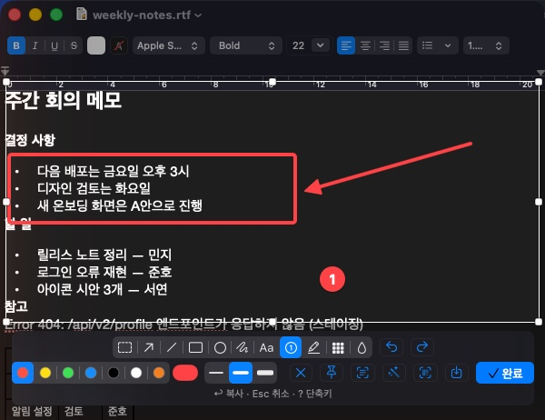
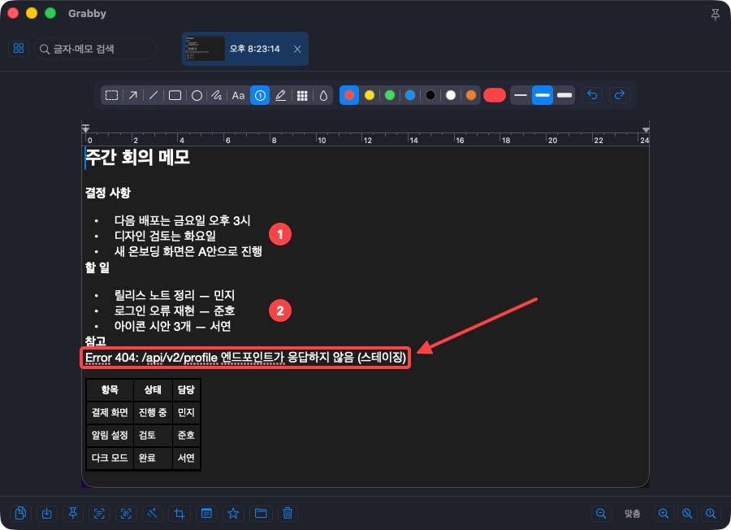
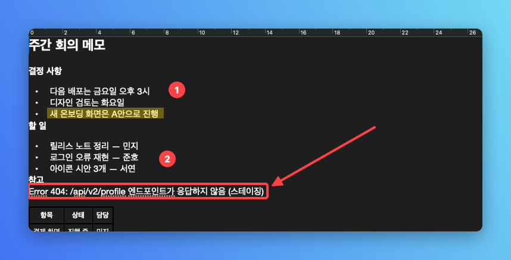

<p align="center">
  
</p>

<h1 align="center">Grabby</h1>

<p align="center">A no-frills macOS menu bar screen capture app<br>Capture, mark it up in place, and paste right away.</p>

<p align="center">
  <a href="https://github.com/eddieee-git/mac-app-grabby/releases/latest">Download the latest version</a> ·
  <a href="#install">Install</a> ·
  <a href="#shortcuts">Shortcuts</a> ·
  <a href="#faq">FAQ</a> ·
  <a href="CHANGELOG.en.md">Changelog</a> ·
  <a href="README.md">한국어</a>
</p>



## Features

- **Edit where you capture**: Select an area and a toolbar appears right there. Draw arrows, boxes, numbered steps, or mosaic, then press ↩.
- **Back to your app instantly**: The capture screen doesn't steal focus, so you can paste with ⌘V in the app you were using.
- **Captures pile up as tabs**: Reopen past captures to fix marks, and find them by their text or your notes.
- **Copy text (OCR)**: Recognizes Korean and English text in images.
- **Read QR codes**: Drag over a QR code on screen to copy its value; links open right in your browser.
- **Beautify**: Adds padding, a background, rounded corners, and a shadow for sharing.
- **Pin to screen**: Keep a capture floating above other windows while you work.

The app's interface is available in Korean and English (Settings → General → Language). The screenshots show the Korean interface.

| Edit again in the tab window | Beautify |
|---|---|
|  |  |

## Install

1. Download `Grabby-x.y.z.dmg` from [Releases](https://github.com/eddieee-git/mac-app-grabby/releases/latest) and open it.
2. Drag **Grabby** into the **Applications** folder.
3. Open Grabby. It isn't signed with an Apple developer ID, so the first launch shows a warning that it can't be opened. Click **Done**, then:
   - **macOS 15 (Sequoia) or later**: In System Settings → Privacy & Security, scroll to the bottom, click **Open Anyway** next to Grabby, then click **Open**.
   - **macOS 14 (Sonoma)**: In Applications, **right-click Grabby → Open**.

   After the first time, it opens normally. If you prefer Terminal, run `xattr -dr com.apple.quarantine /Applications/Grabby.app` instead.
4. The Getting Started window appears on first launch. Turn on **Screen Recording** permission, then click **Restart After Turning On**.
   If you'd rather keep the macOS screenshot shortcuts, click **Use ⌃⌘ Keys** in Getting Started.

**Updating**: From 0.3.1, if update checks are on in Settings, **Install Version…** appears at the top of the menu bar menu when a new version is out. Click it and Grabby downloads and verifies the new version, replaces itself and restarts (no "Not Opened" warning this way). From 0.3.2, Grabby also checks the developer's own signature on the file and won't install it if the signature doesn't match. If Screen Recording permission was reset by the update, Grabby tells you right away. On older versions, or to do it by hand, replace Grabby in Applications with the one from the new dmg. If Grabby asks for Screen Recording permission again, turn Grabby off and on in the Screen & System Audio Recording list, then restart it. Because Grabby has no developer signature, macOS sometimes treats a new version as a different app.

> Requires an Apple silicon Mac with macOS 14 (Sonoma) or later.

Use the camera icon in the menu bar to capture, open the capture window, or open settings.

## How to use

1. Press **⇧⌘1** and the screen freezes. Drag to select an area, or click to pick a window.
   - The loupe next to the cursor lets you line up to the pixel. Press **C** to copy the center pixel's color (#RRGGBB).
2. Draw with the toolbar that appears. Click a mark again to move it, delete it, or change its color.
3. Press **↩** to copy to the clipboard and add it to the tab window. Paste with **⌘V** in your app.
   If you close with **Esc** or ✕ instead, the selected area still goes to the tab window without being copied (you can turn this off in Settings).

Press **?** while capturing to see every shortcut.

## Shortcuts

### Global (changeable in Settings)

| Shortcut | Action |
|---|---|
| ⇧⌘1 | Capture area |
| ⇧⌘2 | Capture the last area again (copied without editing) |
| ⇧⌘3 | Capture full screen: copies the screen under the mouse right away and adds it to tabs, without editing (switch back to the editor in Settings) |
| ⇧⌘4 | Pick a window: the window under the mouse is highlighted (at first, the app you were using); click to capture just that window, without windows behind it |
| ⇧⌘5 | Timer capture (area capture after the set delay, 3 s by default) |
| ⇧⌘` (shown as ⇧⌘₩) | Whiteboard |
| ⇧⌘6 | Read QR code: drag over a QR code to copy its value; links open in your browser |

You can also pick 3, 5, or 10 seconds from the menu bar. The remaining seconds appear large in the middle of the screen. While counting down, press ⇧⌘5 again or choose **Cancel Timer** to stop.

> **⇧⌘3, ⇧⌘4, and ⇧⌘5 are also the macOS screenshot shortcuts.** To use them with Grabby, turn them off in System Settings → Keyboard → Keyboard Shortcuts → Screenshots. Getting Started and Settings → Shortcuts can open that page for you. Or click **Use ⌃⌘ Keys** to switch to ⌃⌘1–5 and ⌃⌘` at once, or change keys one by one.

### Capture screen

| Key | Action |
|---|---|
| Drag / click | Select an area / pick a window |
| F | Select the full screen |
| C | Copy the loupe's center color |
| Handles, arrow keys | Adjust the area (⇧ 10 px, ⌥ resize) |
| ↩ or ⌘C | Copy and add to tabs |
| ⌘S | Save to a file |
| ⌘P | Pin to screen |
| ⌘T | Copy text (OCR) |
| ⌘B | Beautify and copy |
| ⌘R | Read QR |
| ? | Shortcut help |
| Esc | Clear selection / close (keeps the selected area in tabs without copying) |

### Editing tools (capture screen and tab window)

| Key | Tool | Key | Tool |
|---|---|---|---|
| V | Select part | T | Text |
| A | Arrow | N | Numbered step |
| L | Line | H | Highlighter |
| R | Rectangle | M | Mosaic |
| O | Ellipse | B | Blur |
| P | Pen | | |

- Palette colors (6 by default; add up to 12 and reorder them in Settings), a custom color picker, and 3 line widths (text size for text, badge size for steps)
- Hold ⇧ while drawing for 45° arrows and lines, and square boxes and circles
- Marks: click to select, drag to move, ⌫ to delete, double-click text to edit
- ⌘Z undo, ⇧⌘Z redo
- Shortcuts work with a Korean input source, too

### Tab window

| Key | Action |
|---|---|
| ←, → | Previous / next tab |
| ⌘C | Copy (only the selected part, if any) |
| ⌘V | Paste a clipboard image as a new tab |
| ⌘S / ⌘P / ⌘T / ⌘B / ⌘R | Save / pin / copy text / beautify / read QR |
| ⌘+ / ⌘- / ⌘0 / ⌘9 | Zoom in / zoom out / actual size / fit to window |
| ⌫ | Delete the selected mark, or the tab if none |

The tab window also has crop, notes, ★ keep, search, Save All, and Close All.

## Settings

Menu bar → Settings…

| Tab | Items |
|---|---|
| General | Language (한국어/English), theme, launch at login, confirm before deleting tabs, captures to keep, delete old captures (1/7/30/90 days), capture sound, keep in tabs when closed with Esc, show the tab window after capturing, timer delay, bring back pinned captures, open QR links right away, new version alerts and install from the menu (off by default) |
| Editing | Palette (add, remove, drag to reorder) and default color, default width, remember last style, capture toolbar (two rows/one row, center/right, hint), capture only the picked window, copy full-screen captures right away and capture all displays as one image, starting tools, beautify background and padding, whiteboard background |
| Saving | Default save folder, format (PNG/JPEG), save without a dialog, text recognition for search, clear recognized text |
| Shortcuts | Change global shortcuts, switch to ⌃⌘ keys at once; warnings for other capture apps and macOS screenshot shortcuts |
| About | Version, library size, open capture folder, Getting Started, Restart |

## FAQ

**Pressing the shortcut opens another capture app instead of Grabby.**
If another capture app uses the same shortcut, whichever registered first gets the key. Quit that app, or change Grabby's keys in Settings → Shortcuts. Grabby tells you when a known capture app is running.

**Grabby keeps asking for Screen Recording permission.**
Turn Grabby on in System Settings → Privacy & Security → Screen & System Audio Recording, then click **Restart After Turning On** in Getting Started (or Settings → About → Restart). If you just updated and Grabby is already on in the list, turn it off and on, then restart.

**Where are captures stored?**
Captures in the tab window live in `~/Library/Application Support/Grabby/Captures` (Settings → About → Open Capture Folder). To save files elsewhere, use ⌘S or **Save All** in the tab window. When you exceed the number to keep, the oldest are removed first, but ★ kept captures are never removed. To keep sensitive screens such as passwords from lingering, turn on **Delete old captures** in Settings → General to remove captures after a number of days (off by default). Captures are stored unencrypted, only on this Mac.

**Does Grabby send anything over the internet?**
Not by default. Capture, text recognition (OCR), and QR reading happen entirely on your Mac, and no account is needed. Only if you turn on **Tell me about new versions** in Settings → General does Grabby ask GitHub for the latest version number, once a day. It downloads a new dmg from GitHub only when you click **Install Version…** in the menu.

**I'm uneasy about QR links opening by themselves.**
Grabby opens only web addresses (http, https); file addresses and addresses that open other apps are only copied. To stop opening links right away, turn off **Open QR code links in the browser right away** in Settings → General. If there are several QR codes, none are opened and all are copied.

**I think I lost a capture.**
Grabby records every capture deletion and its reason in `~/Library/Application Support/Grabby/events.log`. Please include that file when reporting a problem.

## Uninstall

1. Choose **Quit Grabby** from Grabby's menu bar menu.
2. Move Grabby from Applications to the Trash.
3. To also remove saved captures and settings, run in Terminal:
   ```bash
   rm -rf ~/Library/Application\ Support/Grabby
   defaults delete com.eddieee.Grabby
   ```
4. In System Settings → Privacy & Security → Screen & System Audio Recording, select Grabby and click **−**. If you turned on launch at login, remove it from General → Login Items too.

## Build it yourself

Builds with Command Line Tools only, no Xcode.

```bash
./scripts/build-app.sh      # build/Grabby.app, build/Grabby-<version>.dmg
./scripts/test.sh           # self-tests (doesn't touch your real captures or settings)
./scripts/release.sh        # test → build → tag → GitHub release with the dmg
```

- Release dmgs come with an Ed25519 signature (`.sig`) that in-app updates check. The signing key lives outside the repo at `~/.config/grabby/update-signing.key`; create it once with `swift scripts/sign-update.swift keygen` (no Apple account needed).
- If Screen Recording permission resets after every rebuild, create a local signing certificate once (no Apple account needed): `./scripts/make-signing-cert.sh`
- The icon is drawn by `scripts/make-icon.swift`.
- The testing arguments `-showInDock YES` (show in Dock), `-captureFolder <path>` (use another capture folder), `-updateFeed <url>` (check another update address) and `-autoInstallUpdate YES` (install a new version without asking) work only in debug builds: `GRABBY_DEBUG=1 ./scripts/build-app.sh`
- Developer notes (structure, conventions, testing and release steps) are in [CLAUDE.md](CLAUDE.md) (Korean).

## License

[MIT](LICENSE)
