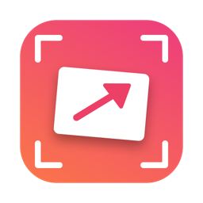
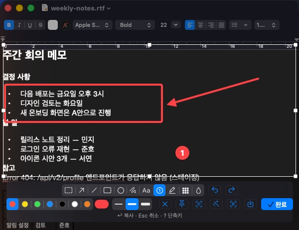
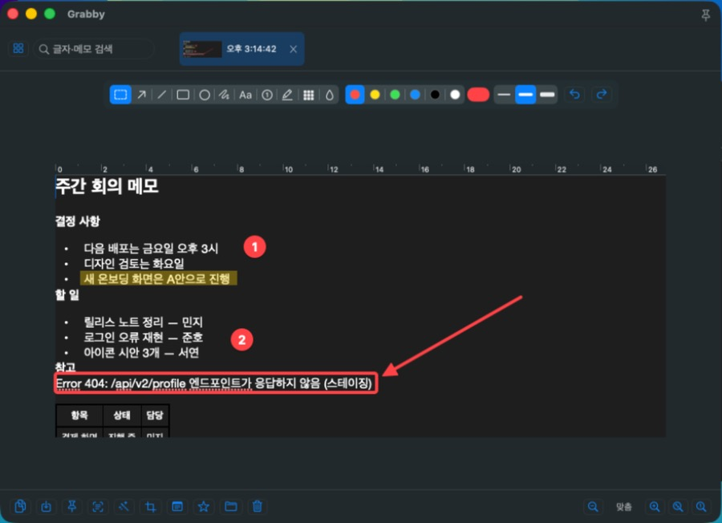
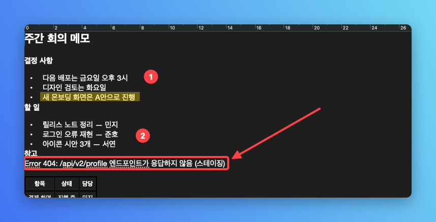

<p align="center">
  
</p>

<h1 align="center">Grabby</h1>

<p align="center">필요한 기능만 담은 macOS 메뉴바 화면 캡처 앱<br>찍고, 그 자리에서 그리고, 바로 붙여 넣으세요.</p>

<p align="center">
  <a href="https://github.com/eddieee-git/mac-app-grabby/releases/latest">최신 버전 내려받기</a> ·
  <a href="#설치">설치</a> ·
  <a href="#단축키">단축키</a> ·
  <a href="#자주-묻는-질문">자주 묻는 질문</a> ·
  <a href="README.en.md">English</a>
</p>



## 특징

- **고른 자리에서 바로 편집**: 영역을 고르면 그 자리에 도구 막대가 떠요. 화살표, 네모, 번호 스티커, 모자이크를 그리고 ↩를 누르면 끝이에요.
- **원래 앱으로 바로 돌아가기**: 캡처 화면이 포커스를 빼앗지 않아서, 끝나자마자 쓰던 앱에서 ⌘V로 붙여 넣을 수 있어요.
- **캡처가 탭으로 쌓여요**: 지난 캡처를 다시 열어 표시를 고치고, 캡처 속 글자나 메모로 찾을 수 있어요.
- **글자 복사(OCR)**: 이미지 속 한국어·영어 글자를 인식해 복사해요.
- **꾸며서 복사**: 여백, 배경, 둥근 모서리, 그림자를 넣어 공유하기 좋은 이미지로 만들어요.
- **화면에 띄우기**: 캡처를 화면 위에 떠 있는 작은 창으로 붙여 두고 보면서 작업할 수 있어요.

| 탭 창에서 다시 고치기 | 꾸며서 복사 |
|---|---|
|  |  |

## 설치

1. [Releases](https://github.com/eddieee-git/mac-app-grabby/releases/latest)에서 `Grabby-x.y.z.dmg`를 내려받아 열어요.
2. **Grabby**를 **Applications** 폴더로 끌어다 놓아요.
3. Grabby를 열어요. Apple 개발자 서명이 없는 앱이라 처음 한 번은 열 수 없다는 경고가 나와요. **완료**를 누른 뒤:
   - **macOS 15(Sequoia) 이상**: 시스템 설정 → 개인정보 보호 및 보안을 맨 아래까지 내려서 Grabby 옆의 **그래도 열기**를 누르고, 한 번 더 **열기**를 눌러요.
   - **macOS 14(Sonoma)**: 응용 프로그램 폴더에서 Grabby를 **오른쪽 클릭 → 열기**를 눌러요.

   한 번 열고 나면 그다음부터는 그냥 열려요.
4. 처음 실행하면 시작 안내 창이 떠요. **화면 기록 권한**을 켜고 **켰으면 다시 시작**을 누르면 준비가 끝나요.
   macOS 스크린샷 단축키를 끄고 싶지 않으면 시작 안내의 **⌃⌘ 키로 바꾸기**를 누르세요.

**업데이트할 때**: 새 dmg의 Grabby를 응용 프로그램 폴더에 덮어쓰면 돼요. 그 뒤 화면 기록 권한을 다시 물으면, 시스템 설정의 화면 및 시스템 오디오 기록 목록에서 Grabby를 한 번 껐다 켜고 다시 시작해 주세요. 개발자 서명이 없는 앱이라 macOS가 새 버전을 다른 앱으로 볼 때가 있어요.

> Apple 실리콘 Mac, macOS 14(Sonoma) 이상에서 동작해요.

메뉴바의 카메라 아이콘에서 캡처, 캡처 창, 설정을 열 수 있어요.

## 쓰는 방법

1. **⇧⌘1**을 누르면 화면이 멈춰요. 드래그해서 영역을 고르거나, 클릭해서 창 하나를 골라요.
   - 커서 옆 돋보기로 픽셀 단위까지 맞출 수 있어요. **C**를 누르면 가운데 픽셀 색(#RRGGBB)을 복사해요.
2. 고른 자리에 뜬 도구 막대로 그려요. 그린 표시는 다시 눌러서 옮기거나, 지우거나, 색을 바꿀 수 있어요.
3. **↩**를 누르면 클립보드에 복사되고 탭 창에 추가돼요. 원래 앱에서 바로 **⌘V**로 붙여 넣으세요.

캡처 중에 **?**를 누르면 모든 단축키를 볼 수 있어요.

## 단축키

### 전역 (설정에서 바꿀 수 있어요)

| 단축키 | 동작 |
|---|---|
| ⇧⌘1 | 영역 캡처 |
| ⇧⌘2 | 마지막 영역 다시 캡처 (편집 없이 바로 복사) |
| ⇧⌘3 | 전체 화면 캡처 |
| ⇧⌘4 | 창 고르기 캡처: 마우스 아래 창이 캡처 영역처럼 강조되고(처음엔 쓰던 앱의 창), 클릭하면 뒤에 겹친 창 없이 그 창만 캡처해요 |
| ⇧⌘5 | 타이머 캡처 (설정한 시간 뒤에 영역 캡처, 기본 3초) |
| ⇧⌘₩ | 화이트보드 |

타이머 캡처는 메뉴바 메뉴에서 3·5·10초를 골라 쓸 수도 있어요. 남은 시간은 화면 가운데에 크게 보여요. 세는 동안 ⇧⌘5를 한 번 더 누르거나 메뉴의 "타이머 취소"를 누르면 멈춰요.

> **⇧⌘3, ⇧⌘4, ⇧⌘5는 macOS 기본 스크린샷 단축키와 같아요.** Grabby로 쓰려면 시스템 설정 → 키보드 → 키보드 단축키 → 스크린샷에서 해당 항목을 꺼 주세요. 시작 안내와 설정 → 단축키에서 바로 열 수 있어요. 끄고 싶지 않으면 **⌃⌘ 키로 바꾸기**를 눌러 ⌃⌘1~5, ⌃⌘₩로 한 번에 바꾸거나, 하나씩 다른 키로 바꾸면 돼요.

### 캡처 화면

| 키 | 동작 |
|---|---|
| 드래그 / 클릭 | 영역 고르기 / 창 고르기 |
| F | 전체 화면 고르기 |
| C | 돋보기 가운데 색 복사 |
| 손잡이, 방향키 | 영역 조정 (⇧ 10px, ⌥ 크기) |
| ↩ 또는 ⌘C | 복사하고 탭에 추가 |
| ⌘S | 파일로 저장 |
| ⌘P | 화면에 띄우기 |
| ⌘T | 글자 복사 (OCR) |
| ⌘B | 꾸며서 복사 |
| ? | 단축키 도움말 |
| Esc | 선택 풀기 / 취소 |

### 편집 도구 (캡처 화면과 탭 창)

| 키 | 도구 | 키 | 도구 |
|---|---|---|---|
| V | 부분 선택 | T | 텍스트 |
| A | 화살표 | N | 번호 스티커 |
| L | 직선 | H | 형광펜 |
| R | 네모 | M | 모자이크 |
| O | 동그라미 | B | 흐리게 |
| P | 자유그리기 | | |

- 팔레트 색(기본 6가지, 설정에서 최대 12가지까지 더하고 빼기)과 직접 고르기, 굵기 3단계(텍스트는 글자 크기, 번호는 크기)
- ⇧를 누르고 그리면 화살표·직선은 45도, 네모·동그라미는 정사각형·정원
- 그린 표시: 눌러서 고르기, 끌어서 옮기기, ⌫ 지우기, 텍스트는 더블클릭으로 고치기
- ⌘Z 되돌리기, ⇧⌘Z 다시 실행
- 한글 입력 상태에서도 그대로 동작해요

### 탭 창

| 키 | 동작 |
|---|---|
| ←, → | 이전·다음 탭 |
| ⌘C | 복사 (부분 선택이 있으면 그 부분만) |
| ⌘V | 클립보드 이미지를 새 탭으로 |
| ⌘S / ⌘P / ⌘T / ⌘B | 저장 / 화면에 띄우기 / 글자 복사 / 꾸며서 복사 |
| ⌘+ / ⌘- / ⌘0 / ⌘9 | 확대 / 축소 / 실제 크기 / 창에 맞추기 |
| ⌫ | 고른 표시 지우기, 없으면 탭 삭제 |

탭 창에서는 자르기, 메모, ★ 고정, 검색, 모두 저장, 모두 닫기도 쓸 수 있어요.

## 설정

메뉴바 → 설정…

| 탭 | 항목 |
|---|---|
| 일반 | 언어(한국어/English), 테마, 로그인 시 실행, 탭 삭제 확인, 보관할 캡처 수, 캡처 소리, 캡처하면 탭 창 띄우기, 타이머 캡처 시간, 띄운 캡처 되살리기, 새 버전 알림(기본 꺼짐) |
| 편집 | 팔레트(색 더하기·빼기·끌어서 순서 바꾸기)·기본 색, 기본 굵기, 마지막에 쓴 값 기억, 캡처 도구 막대(두 줄/한 줄, 가운데/오른쪽, 안내 문구), 고른 창만 캡처, 캡처·화이트보드 시작 도구, 꾸미기 배경·여백, 화이트보드 바탕 |
| 저장 | 기본 저장 폴더, 형식(PNG/JPEG), 저장 창 없이 바로 저장, 글자 인식 검색 켜기·인식한 글자 지우기 |
| 단축키 | 전역 단축키 바꾸기, ⌃⌘ 키로 한 번에 바꾸기, 다른 캡처 앱·macOS 스크린샷 단축키와 겹침 경고 |
| 정보 | 버전, 캡처 폴더 열기, 시작 안내, 다시 시작 |

## 자주 묻는 질문

**단축키를 눌러도 Grabby가 아니라 다른 캡처 앱이 떠요.**
다른 캡처 앱이 같은 단축키를 쓰고 있으면 먼저 등록한 앱이 키를 받아요. 그 앱을 끄거나, Grabby 설정 → 단축키에서 다른 키로 바꿔 주세요. 알려진 캡처 앱이 켜져 있으면 Grabby가 알려 줘요.

**캡처하려는데 화면 기록 권한을 계속 물어봐요.**
시스템 설정 → 개인정보 보호 및 보안 → 화면 및 시스템 오디오 기록에서 Grabby를 켠 뒤, 시작 안내의 "켰으면 다시 시작"(또는 설정 → 정보 → 다시 시작)을 눌러 주세요. 업데이트한 뒤라 목록에 이미 켜져 있다면, 한 번 껐다 켜고 다시 시작해 주세요.

**캡처는 어디에 저장돼요?**
탭 창에 쌓인 캡처는 `~/Library/Application Support/Grabby/Captures`에 있어요(설정 → 정보 → 캡처 폴더 열기). 파일로 따로 저장하려면 ⌘S나 탭 창의 "모두 저장"을 쓰세요. 보관할 개수를 넘으면 오래된 것부터 정리되는데, ★ 고정한 캡처는 지우지 않아요.

**인터넷에 무언가를 보내나요?**
기본으로는 아무것도 보내지 않아요. 캡처, 글자 인식(OCR)은 모두 이 Mac 안에서만 처리하고 계정도 필요 없어요. 설정 → 일반에서 "새 버전이 나오면 알려 주기"를 켠 경우에만 하루 한 번 GitHub에 최신 버전 번호를 물어봐요.

**캡처를 알 수 없이 잃어버린 것 같아요.**
Grabby는 캡처를 지울 때마다 이유를 `~/Library/Application Support/Grabby/events.log`에 남겨요. 문제를 알릴 때 이 파일을 함께 보내 주세요.

## 직접 빌드하기

Xcode 없이 Command Line Tools만으로 빌드해요.

```bash
./scripts/build-app.sh      # build/Grabby.app, build/Grabby.dmg
./scripts/test.sh           # 자동 점검 (실제 보관함·설정은 건드리지 않음)
./scripts/release.sh        # 점검 → 빌드 → 태그 → GitHub 릴리스(dmg 첨부)
```

- 다시 빌드할 때마다 화면 기록 권한이 풀리면, 이 Mac 전용 서명 인증서를 한 번 만들어 두세요(Apple 계정 불필요): `./scripts/make-signing-cert.sh`
- 아이콘은 `scripts/make-icon.swift`로 그려요.
- 점검용 실행 인자 `-showInDock YES`(Dock에 표시), `-captureFolder <경로>`(다른 보관함 사용)는 디버그 빌드에서만 동작해요: `GRABBY_DEBUG=1 ./scripts/build-app.sh`

## 라이선스

[MIT](LICENSE)
